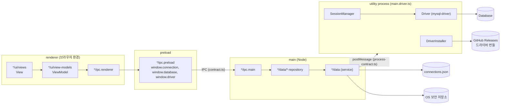
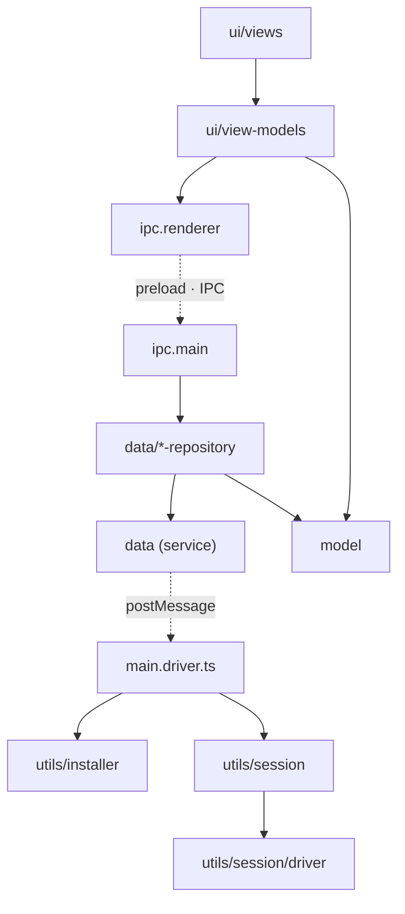
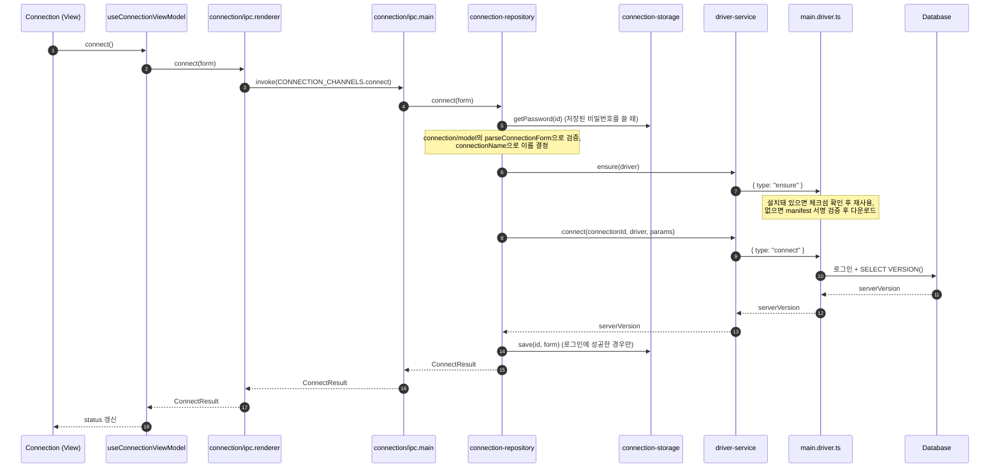

# 아키텍처 설계

data pump 데스크톱 앱의 코드 구조와 그렇게 나눈 이유를 기록합니다. README의 "프로젝트 구조", "애플리케이션 구조"는 이 문서를 요약한 것입니다.

참고 문서

- Electron 프로세스 모델: https://www.electronjs.org/docs/latest/tutorial/process-model
- Flutter 앱 아키텍처 가이드: https://docs.flutter.dev/app-architecture/guide

## 1. 설계 원칙

1. **프로세스 경계는 Electron을 따르고, 책임 분리는 MVVM을 따른다.**
   Electron의 main, preload, renderer, utility process는 보안과 격리를 위한 런타임 경계입니다. 코드의 책임은 Flutter 앱 아키텍처 가이드의 MVVM 레이어(UI layer, Data layer)로 나눕니다.
2. **디렉터리는 도메인으로 먼저 나누고, 그 안에서 레이어로 나눈다.**
   `src/` 아래에는 `connection/`, `database/`처럼 도메인 폴더를 두고, 각 도메인 안에 `model/`, `ui/`, `data/`와 IPC 파일을 둡니다. 한 도메인이 어떻게 구성되고 동작하는지 폴더 하나만 열어 보고 파악할 수 있게 하기 위해서입니다.
3. **프로세스 경계는 파일 이름과 lint로 드러낸다.**
   같은 도메인 폴더 안에 여러 프로세스의 코드가 함께 있으므로, 어느 프로세스에서 실행되는지를 파일 이름(`ipc.main.ts`, `ipc.preload.ts`, `ipc.renderer.ts`)과 레이어 폴더(`ui/`는 renderer, `data/`는 main)로 구분하고 lint 규칙으로 지킵니다.
4. **Electron 고유의 코드는 진입점에만 둔다.**
   앱 생명주기, 창 생성, preload, utility process 진입점은 `apps/desktop/` 루트의 진입점 파일에 둡니다. 진입점은 도메인의 `register…`/`expose…`를 호출해 조립만 합니다.
5. **의존은 한 방향으로만 흐른다.**
   상위 레이어는 아래 레이어만 사용하고, 하위 레이어는 상위를 모릅니다. 이 규칙은 문서가 아니라 lint 규칙(`eslint.config.js`)으로 강제합니다.
6. **renderer에는 필요한 API만 노출한다.**
   Electron 문서의 권고에 따라 preload는 `contextBridge`로 도메인 단위 API만 노출하고, `ipcRenderer` 같은 권한이 큰 객체는 노출하지 않습니다.

### 용어

| 용어             | 뜻                                 | 코드                                                              |
| ---------------- | ---------------------------------- | ----------------------------------------------------------------- |
| Connection       | 사용자가 저장한 접속 정보 (프로필) | desktop `src/connection/` (`SavedConnection`, `StoredConnection`) |
| ActiveConnection | Apply로 고른 현재 접속             | desktop `connection-repository`                                   |
| Session          | DB와 실제로 열려 있는 연결         | utils `src/session/` (`SessionManager`, `DriverSession`)          |

## 2. 프로세스와 레이어



| 레이어        | 위치                                          | 실행 프로세스 | 책임                                                                                                                                                |
| ------------- | --------------------------------------------- | ------------- | --------------------------------------------------------------------------------------------------------------------------------------------------- |
| View          | `src/<도메인>/ui/views/`                      | renderer      | 화면을 그리고 사용자 이벤트를 ViewModel에 전달합니다. 비즈니스 로직은 갖지 않습니다.                                                                |
| ViewModel     | `src/<도메인>/ui/view-models/`                | renderer      | 화면 상태를 보관하고, 데이터를 화면에 맞게 가공하며, View가 호출할 command를 노출합니다. View와 기능 단위로 1:1입니다.                              |
| Model         | `src/<도메인>/model/`                         | 모두          | 도메인 값의 변환·검증·표시 문자열 같은 순수 함수입니다. renderer와 main이 같은 코드를 씁니다.                                                       |
| 계약          | `src/<도메인>/contract.ts`                    | 모두          | IPC 채널 이름과 API 타입입니다. main·preload·renderer가 이 파일을 기준으로 맞춥니다.                                                                |
| IPC           | `src/<도메인>/ipc.{renderer,preload,main}.ts` | 각 프로세스   | renderer는 preload가 노출한 API를 쓰고(`ipc.renderer`), preload는 API를 노출하고(`ipc.preload`), main은 채널을 Repository에 연결합니다(`ipc.main`). |
| Repository    | `src/<도메인>/data/*-repository.ts`           | main          | 앱 데이터의 source of truth입니다. 여러 Service를 조합해 하나의 흐름(예: 접속)을 완성합니다.                                                        |
| Service       | `src/<도메인>/data/` (repository 외)          | main          | 파일, OS 보안 저장소, 드라이버 프로세스 같은 외부 소스 하나를 감쌉니다.                                                                             |
| 생명주기      | `main.ts`                                     | main          | 앱 생명주기와 창을 관리하고, data layer를 조립해 도메인별 `register…Ipc`로 연결합니다.                                                              |
| 드라이버 작업 | `main.driver.ts`                              | utility       | 드라이버 설치와 DB 세션을 맡습니다. DB 드라이버가 죽거나 오래 걸려도 main이 영향을 받지 않도록 별도 프로세스로 둡니다.                              |

## 3. 디렉터리 구조

### 3.1 모노레포

```
data-pump/
├── apps/
│   └── desktop/            Electron 데스크톱 앱
├── packages/
│   ├── components/         공용 React 컴포넌트 (화면에 묶이지 않는 UI)
│   ├── utils/              DB 세션·드라이버 설치 로직과 renderer와 공유하는 타입
│   ├── conventions/        공용 ESLint·Prettier 설정
│   └── drivers/            DB 드라이버 번들 빌드·서명 스크립트 (CI 전용, 워크스페이스에서 제외)
├── docs/                   설계 문서
└── eslint.config.js        레이어 의존 규칙을 포함한 lint 설정
```

### 3.2 apps/desktop

```
apps/desktop/
├── main.ts                 main 진입점: 앱 생명주기, 창, data layer 조립, register…Ipc 호출
├── preload.ts              preload 진입점: expose…Api 호출
├── main.driver.ts          utility process 진입점: 드라이버 설치·DB 세션 요청 처리
├── src/
│   ├── main.tsx            화면 진입점 (index.html이 로드)
│   ├── app/                화면 전환 (접속 화면 ↔ 작업 화면)
│   │   └── ui/             App.tsx, view-models/useAppViewModel.ts
│   ├── connection/         저장된 접속 정보와 현재 접속 (README.md 참고)
│   │   ├── model/          connection-form.ts, connection-label.ts
│   │   ├── contract.ts     IPC 채널·ConnectionApi
│   │   ├── ipc.main.ts / ipc.preload.ts / ipc.renderer.ts
│   │   ├── data/           connection-repository.ts, connection-storage.ts, secret-store.ts
│   │   └── ui/             views/, view-models/ (접속 설정 화면)
│   ├── database/           접속한 DB의 개요·쿼리 조회와 작업 화면 (README.md 참고)
│   │   ├── contract.ts, ipc.*.ts
│   │   ├── data/           database-repository.ts
│   │   └── ui/             작업 화면 Workspace (상단 탭, 사이드바, 상태 바)
│   │       ├── views/, view-models/
│   │       ├── overview/   OVERVIEW 탭
│   │       └── query/      QUERY 탭 (SQL 실행, 결과 표)
│   └── driver/             드라이버 설치와 utility process 통신
│       ├── contract.ts     renderer ↔ main (DriverApi)
│       ├── process-contract.ts  main ↔ utility process (DriverRequest·DriverResponses)
│       ├── ipc.*.ts
│       └── data/           driver-process.ts, driver-service.ts
└── test/                   src/와 같은 구조 (vitest)
```

- 도메인은 데이터와 그 흐름, 그 데이터를 보여 주는 화면이 묶이는 단위입니다. `connection`은 저장된 접속과 현재 접속(접속 설정 화면 포함)을, `database`는 접속한 DB의 데이터(작업 화면 포함)를, `driver`는 드라이버 설치와 utility process 통신을 맡습니다.
- 화면은 그 화면이 보여 주는 데이터의 도메인 안에 둡니다. 화면 이름(Workspace)이 아니라 다루는 대상(database)으로 폴더를 정합니다. 그래야 기능 하나(예: query)의 화면·계약·조회가 한 폴더 안에 모입니다.
- `app`은 어느 도메인의 화면을 보여 줄지 정하는, 도메인 사이를 조합하는 층이라 따로 둡니다. 데이터 없이 `ui/`만 있습니다.
- `database`는 `connection`에서 `ActiveConnection` 타입만 받아 씁니다. 두 도메인은 서로의 코드를 import하지 않습니다.
- 한 화면 안의 탭은 그 화면의 `ui/` 아래에 `<탭>/views`, `<탭>/view-models`로 둡니다 (예: `database/ui/overview/`).
- Repository와 Service는 `create…` 팩토리로 만들고, 의존성과 상태는 팩토리 안에 둡니다. `main.ts`가 Service → Repository 순서로 한 번 조립합니다. `data/` 안에서 `*-repository.ts`가 Repository이고 나머지는 Service입니다.
- 진입점 세 파일은 루트에 둡니다. Electron Forge의 Vite 플러그인이 진입점 파일 이름으로 빌드 결과물 이름(`main.js`, `preload.js`, `main.driver.js`)을 정하기 때문에, 디렉터리를 옮기더라도 파일 이름은 서로 달라야 합니다. `package.json`의 `main`과 `main.ts`의 preload·fork 경로가 이 이름에 의존합니다.

### 3.3 packages/utils

```
packages/utils/
├── index.ts                main·utility process 전용 입구 (Node 모듈 사용)
├── client.ts               renderer에서도 안전한 입구 (타입만, Node 의존성 없음)
└── src/
    ├── session/            DB 세션을 connectionId별로 관리하는 상위 계층 (utility process)
    │   ├── SessionManager.ts
    │   └── driver/         DB와 직접 통신하는 하위 계층 (session 내부 구현)
    │       ├── Driver.ts   ConnectParams, DriverSession, Driver 인터페이스
    │       ├── mysql-driver.ts
    │       └── index.ts    DRIVERS 목록
    └── installer/          드라이버 번들 다운로드·검증·로드 (session과 독립)
        ├── DriverInstaller.ts
        ├── checksum.ts
        ├── download.ts
        └── manifest.ts
```

- utils는 Electron과 앱 도메인(저장된 접속 정보, 화면)을 모르는 DB 엔진 라이브러리입니다. 앱의 접속 정보 저장은 desktop `connection/`이 맡습니다.
- 모든 DB 요청은 `SessionManager → Driver` 순서로 흐릅니다. 그래서 `driver/`는 `session/`의 내부 구현으로 두고, 패키지 입구(`index.ts`)에서도 내보내지 않습니다.
- `installer/`와 `session/`은 서로를 모릅니다. 둘은 `main.driver.ts`에서 `new SessionManager((name) => installer.load(name))`로 조립합니다.

## 4. 의존 규칙



`eslint.config.js`의 `no-restricted-imports`가 아래 규칙을 강제합니다.

| 대상                                       | 금지하는 import                                                                                            | 이유                                                                |
| ------------------------------------------ | ---------------------------------------------------------------------------------------------------------- | ------------------------------------------------------------------- |
| `src/*/ui/**`, `src/main.tsx`              | `data/`, `ipc.main`, `ipc.preload`, `process-contract`, `electron`, `node:*`, `@packages/utils`(루트 입구) | renderer에서 실행되므로 main·Node 코드가 섞이면 깨집니다.           |
| `src/*/ui/**/views/**`                     | 위 항목 + `ipc.*`                                                                                          | View는 ViewModel을 통해서만 데이터에 접근합니다.                    |
| `src/*/model/**`                           | `ui/`, `data/`, `electron`, `node:*`, `@packages/utils`(타입 import만 허용)                                | renderer와 main이 함께 쓰는 순수 코드입니다.                        |
| `src/*/contract.ts`, `process-contract.ts` | `ui/`, `data/`, `model/`, `ipc.*`, `electron`, `node:*`, `@packages/utils`(타입만)                         | 모든 프로세스가 import하므로 타입과 상수만 둡니다.                  |
| `src/*/ipc.renderer.ts`                    | `ui/`, `data/`, `ipc.main`, `ipc.preload`, `electron`, `node:*`                                            | renderer에서 preload가 노출한 API(`window.*`)만 사용합니다.         |
| `src/*/ipc.preload.ts`                     | `ui/`, `data/`, `node:*`                                                                                   | preload는 IPC 다리 역할만 합니다.                                   |
| `src/*/ipc.main.ts`                        | `ui/`, `ipc.renderer`, `ipc.preload`                                                                       | main에서 실행되며 채널을 Repository에 연결만 합니다.                |
| `src/*/data/**/*-repository.ts`            | `ui/`, `ipc.*`                                                                                             | 하위 레이어는 상위를 모릅니다.                                      |
| `src/*/data/**` (repository 외)            | `*-repository`, `ui/`, `ipc.*`                                                                             | Repository → Service 방향만 허용합니다.                             |
| `utils/src/installer/**`                   | `session`                                                                                                  | installer와 session은 독립입니다.                                   |
| `utils/src/session/*.ts`                   | `installer`, `./driver/<파일>`                                                                             | 드라이버 모듈은 주입받고, driver는 입구(`./driver`)로만 사용합니다. |
| `utils/src/session/driver/**`              | 상위 `session` 파일, `installer`                                                                           | 하위 계층은 상위를 모릅니다.                                        |
| `utils/index.ts`                           | `session/driver`                                                                                           | driver는 session을 통해서만 사용합니다.                             |
| `utils/client.ts`                          | `node:*`, 상대 경로                                                                                        | renderer에서 쓰이는 입구라 Node 코드가 섞이면 안 됩니다.            |

## 5. 요청 흐름: 접속(Connect)



- 단계별 진행 상황(`driver`, `login`, `save`)과 드라이버 다운로드 진행률은 main이 `connection:progress`, `driver:progress` 이벤트로 renderer에 보냅니다.
- 복호화한 비밀번호는 main 밖으로 보내지 않습니다. renderer는 저장 여부(`hasPassword`)만 받습니다.
- driver process 메시지 형식은 `driver/process-contract.ts`에 타입으로 정의되어 있고, 그것을 함수로 감싼 것은 `driver-service`뿐입니다. Repository는 타입이 붙은 함수(`ensure`, `connect`, `hasSession` 등)만 호출합니다.

## 6. 드라이버 배포

DB 드라이버(mysql2 등)는 앱에 포함하지 않고, 필요할 때 내려받습니다.

1. CI(`.github/workflows/drivers.yaml`)가 `packages/drivers`에서 드라이버를 esbuild로 번들링하고 실제 DB에 붙여 smoke test를 합니다.
2. 번들 목록과 sha256을 담은 manifest를 Ed25519로 서명해 GitHub Releases에 올립니다.
3. 앱의 `DriverInstaller`는 앱에 포함된 공개키(`TRUSTED_KEYS`)로 manifest 서명을 확인하고, 만료와 롤백(sequence 감소)을 거부한 뒤, 번들을 내려받아 체크섬을 검증합니다. 로드하기 직전에도 체크섬을 다시 확인합니다.

## 7. 설계 결정 기록

| 결정                                                                                     | 이유                                                                                                                                                                                                      |
| ---------------------------------------------------------------------------------------- | --------------------------------------------------------------------------------------------------------------------------------------------------------------------------------------------------------- |
| `DriverManager` → `DriverInstaller`                                                      | 실제 역할이 드라이버 설치·검증·로드였습니다. JDBC의 `DriverManager`처럼 접속까지 하는 것으로 오해하기 쉬웠습니다.                                                                                         |
| `DriverAdapter` → `Driver`, `connection/driver/`로 이동                                  | DB와 직접 통신하는 하위 계층입니다. 모든 요청이 connection을 거치므로 connection의 내부 구현으로 둡니다.                                                                                                  |
| installer는 connection과 같은 높이에 둠                                                  | installer는 접속과 무관하게 따로 호출되고(`install`, `ensure`), connection은 installer를 직접 모릅니다.                                                                                                   |
| utils `ConnectionRepository` → `ConnectionStorageService`                                | 파일 하나를 감싸는 역할이라 Flutter 가이드의 Service에 해당합니다. 여러 Service를 조합하는 desktop의 `connection-repository.ts`가 Repository입니다.                                                       |
| desktop을 프로세스(`main/`, `renderer/`)가 아닌 레이어(`ui/`, `data/`)로 나눔            | 디렉터리 이름이 Electron에 묶이지 않게 하기 위해서입니다. 대신 `data/` 안에 renderer 코드(`clients/`)와 main 코드가 함께 있으므로 lint로 경계를 지킵니다. (이후 도메인 우선 구조로 바꿨습니다. 아래 참고) |
| 진입점 세 파일은 루트에 유지                                                             | Forge 빌드 결과물 이름이 진입점 파일 이름을 따르기 때문입니다.                                                                                                                                            |
| preload에서 `ipcRenderer`, `versions` 노출 제거                                          | Electron 보안 권고에 따라 기능 단위 API만 노출합니다. 사용하는 곳도 없었습니다.                                                                                                                           |
| `driver-service` 추가                                                                    | Repository가 driver process 메시지 형식을 직접 만들고 있었습니다. 외부 소스를 감싸는 일은 Service의 책임이라 형식을 Service 한 곳에 모았습니다.                                                           |
| `connection-repository`에서 `database-repository` 분리                                   | 개요·쿼리 조회는 저장된 접속 정보와 다른 종류의 데이터입니다. Repository는 데이터 종류마다 하나씩 둡니다.                                                                                                 |
| Repository를 팩토리(`create…Repository`)로 만듦                                          | 모듈 전역 상태와 호출마다 넘기던 의존성을 팩토리 안으로 옮겨, `main.ts`가 data layer를 한 번 조립하도록 했습니다.                                                                                         |
| desktop을 레이어(`ui/`, `data/`) 대신 도메인(`connection/`, `database/` …)으로 먼저 나눔 | 레이어 기준으로 나누니 connection 하나를 이해하려면 패키지 2곳, 레이어 4곳의 파일 12개를 오가야 했습니다. 도메인 폴더 하나에 model·IPC·data·ui를 모아 맥락 없이도 구성과 동작을 파악할 수 있게 했습니다.  |
| 접속 정보 포맷·변환을 `connection/model`로 모음                                          | 같은 주소 문자열을 만드는 함수가 utils·repository·ViewModel에 하나씩, 폼 변환이 세 곳에 따로 있었습니다. renderer와 main이 같은 순수 함수를 씁니다.                                                       |
| IPC 채널·API 타입을 `contract.ts`로 코드화, `data/clients`·`global.d.ts` 제거            | 채널 이름이 `main.ts`와 `preload.ts`에 따로 적혀 있었고, driver process 메시지 규약은 주석뿐이었습니다. 계약을 타입으로 두어 어긋나면 컴파일 에러가 나게 했습니다.                                        |
| overview·query를 `connection`에서 `database`로 분리                                      | `connection:overview` 채널을 `database-repository`가 처리하는 등 이름과 책임이 어긋났습니다. 작업 화면은 이제 connection API를 모릅니다.                                                                  |
| `ConnectionStorageService`를 utils에서 desktop `connection/data`로 이동                  | Node `fs`와 앱 화면 폼에 의존하는 desktop 전용 도메인 코드였습니다. utils는 세션과 드라이버 설치만 맡습니다.                                                                                              |
| utils `connection/` → `session/`, `ConnectionManager` → `SessionManager`                 | "connection"이 저장된 접속 정보, 현재 접속, DB 세션 세 가지 뜻으로 쓰였습니다. DB와 실제로 열린 연결은 session으로 부릅니다.                                                                              |
| `workspace/`(화면)를 `database/ui/`로 합침                                               | `database`에는 data만, `workspace`에는 ui만 있어 도메인 이름을 붙인 레이어 분리와 같았습니다. query 하나를 보려면 두 폴더를 오가야 했습니다. 화면은 그 화면이 보여 주는 데이터의 도메인 안에 둡니다.      |

## 8. 남은 과제

- DB 접속에 TLS 옵션이 없습니다. 접속 폼의 SSL 모드부터 `mysql-driver.ts`의 `ssl` 옵션까지 추가해야 합니다.
- `driver:install` IPC 핸들러(`driver/ipc.main.ts`)는 Repository 없이 `driver-service`를 바로 호출합니다. 드라이버 관리 화면이 생기면 Repository를 둡니다.
- tsconfig가 하나라 renderer 코드에서 Node 타입을 써도 컴파일 오류가 나지 않습니다. 지금은 lint가 막고 있고, 필요하면 renderer용과 main용 tsconfig를 나눕니다.
